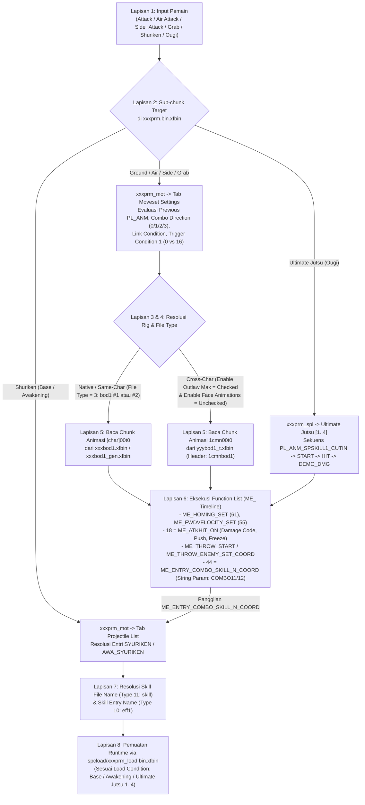

# ARGON MASTER RESEARCH REPORT: NARUTO STORM CONNECTIONS & STORM 4 MOVESET REVERSE ENGINEERING (`NSC-MOVESET-RESEARCH-001`)

**Mode Operasi**: `ARGON — NSC MOVESET REVERSE ENGINEERING LAB`
**Target Utama**: *Naruto x Boruto: Ultimate Ninja Storm Connections* (`NSUNSC` PC / Steam)
**Target Sekunder**: *Naruto Shippuden: Ultimate Ninja Storm 4* (`NSUNS4` PC / Steam v1.09)
**Ruang Lingkup Riset**: Air Combo, Ultimate Jutsu, Shuriken, Grab, dan Old Side Combo (beserta arsitektur dasar `PL_ANM_ATK`)

## BAGIAN A — EXECUTIVE SUMMARY

Penelitian ini membedah secara menyeluruh seri tutorial modding moveset karya [Medrej Storm™ (@MedrejStorm)](https://www.youtube.com/watch?v=TKH_TtuOhNI) beserta ekosistem tool [NSC Toolbox](https://github.com/TheLeonX/NSC-Toolbox) dan [NSC Mod Manager](https://github.com/TheLeonX/NSC-ModManager) oleh [TheLeonX](https://github.com/TheLeonX). Temuan kunci yang berhasil dibuktikan:

1. **Arsitektur Dua Lapis (`spcload` Manifest $\rightarrow$ `spc/prm` State Table) (`[VERIFIED IN VIDEO]` & `[VERIFIED IN SOURCE]`)**:
   Seluruh modifikasi moveset yang melibatkan aset di luar file bawaan karakter wajib melalui dua lapisan:
   - **Lapisan Manifest Pemuatan (`data_win32/spcload/xxxprm_load.bin.xfbin`)**: Diedit menggunakan **Character File Loader Editor** untuk mendaftarkan path, nama file, `Type` (`3 - bod1`, `10 - eff1`, `11 - skill`), dan `Load Condition` (`Base`, `Awakening`, `Ultimate Jutsu 1..4`).
   - **Lapisan State & Referensi (`data_win32/spc/xxxprm.bin.xfbin`)**: Diedit menggunakan **Character Moveset Editor** pada sub-chunk **`xxxprm_mot`** (untuk Ground Combo, Air Combo, Side Combo, Grab, dan Shuriken) atau **`xxxprm_spl`** (untuk Ultimate Jutsu).
2. **Pemisahan Lima Mekanisme Modifikasi (`[VERIFIED IN VIDEO]`)**:
   - **Old Side Combo ([Video 5](https://www.youtube.com/watch?v=YKgLFsMCpm0))**: Mengaktifkan kembali predikat arah **`Combo Direction = 3 = Side`** yang ternyata masih ada di dalam engine *Storm Connections*, dengan menyalin node `PL_ANM_ATK07` s.d. `PL_ANM_ATK11` (`Previous PL_ANM = PL_ANM_ATK04`) dan mengikatnya ke container `1sskbod1_gen.xfbin` (slot `3 = bod1` kedua di `File Type`) tanpa perlu hex editing karena `characode` karakter sama (`1ssk00t0`).
   - **Grab Lintas Karakter ([Video 4](https://www.youtube.com/watch?v=K_DrvEl2XBE))**: Memindahkan 3 section tersinkronisasi (`PL_ANM_THROW_BEGIN`, `PL_ANM_THROW_SUCCESS_ATTACKER`, `PL_ANM_THROW_SUCCESS_VICTIM`) dari karakter berbeda (`2skr` $\rightarrow$ `1skr`). Agar animasi `2skrbod1_trw00/01/01_e` dapat diikat ke kerangka `1skr`, dilakukan **retargeting biner di HxD** (mengubah `2skr00t0` pertama pada offset `0x180` menjadi `1cmnbod1` dan 200 kemunculan `2skr00t0` berikutnya menjadi `1cmn00t0`), memetakan efek benturan `COMBO11`/`COMBO12` (`44 = ME_ENTRY_COMBO_SKILL_N_COORD`), serta mencentang **`Enable Outlaw Max`** dan menghapus centang **`Enable Face Animations`**.
   - **Shuriken ([Video 3](https://www.youtube.com/watch?v=XMqRwv2715s))**: Tidak mengubah state gerakan `PL_ANM`, melainkan memodifikasi entri simbolik **`SYURIKEN`** dan **`AWA_SYURIKEN`** di tab **`Projectile List`** (`1nrtprm_mot`) agar menunjuk ke `Skill File Name: 5mdr_a_skn00` (`Type: 11 - skill`) dan `Skill Entry Name: 5mdreff1_skn_e_begin00` (`Type: 10 - eff1`).
   - **Ultimate Jutsu ([Video 2](https://www.youtube.com/watch?v=DgEzO1SHwKk) & Frame Silang `YKgLFsMCpm0` `01:15`)**: Beroperasi di dalam sub-chunk khusus **`xxxprm_spl`** (`Ultimate Jutsu [1]`) yang memiliki 7 state (`PL_ANM_SPSKILL1_CUTIN_NC`, `CUTIN`, `START`, `HIT`, `DEMO_DMG`, `DEMO_ATK_END`, `TEAM_WAIT`) serta daftar proyektil khusus (`COMBO11: 3nrtspl1_00`, `SPSKILL_CUTIN_EFF_SOIL/WATER/SNOW`, `SPSKILL_EYE00`) yang dimuat dengan `Load Condition: Ultimate Jutsu 1`.
   - **Air Combo ([Video 1](https://www.youtube.com/watch?v=TcxS3Ues9TI) & Frame Silang Video 4/5)**: Dikendalikan oleh rantai state **`PL_ANM_ATK_AIR00` s.d. `PL_ANM_ATK_AIR05`** di dalam `xxxprm_mot` (tepat di atas `PL_ANM_THROW_BEGIN`), menggunakan mekanisme pengikatan `bod1` yang sama dengan Video 4 (lintas karakter) dan Video 5 (karakter sama).

## BAGIAN B — SOURCE ACCESS REPORT

| No | Judul Video & URL | Tanggal Publikasi & Durasi | Status Akses Konten | Bukti yang Berhasil Diperiksa |
| :--- | :--- | :--- | :--- | :--- |
| **1** | [[NSUNSC Mod Tutorial] Changing Air Combo](https://www.youtube.com/watch?v=TcxS3Ues9TI) | 4 Oktober 2025 \| `06:45` (`PT6M45S`) | **Metadata & Deskripsi Terverifikasi + Bukti Visual Silang dari Video 4 & 5** | Halaman YouTube berhasil diperiksa (`[VERIFIED IN VIDEO]`). Stream visual `TcxS3Ues9TI` tidak tersedia di cache tool karena durasi >6 menit, tetapi daftar section `PL_ANM_ATK_AIR00` s.d. `PL_ANM_ATK_AIR05` terekam jelas di layar editor pada Video 4 (`02:34–03:18`), Video 5 (`03:01`), dan `TKH_TtuOhNI` (`00:51–01:48`). |
| **2** | [[NSUNSC Mod Tutorial] Changing Ultimate Jutsu](https://www.youtube.com/watch?v=DgEzO1SHwKk) | 22 September 2025 \| `06:11` (`PT6M11S`) | **Metadata & Deskripsi Terverifikasi + Jendela Editor Proyek Ini Terekam di Video 5 (`01:15`) & Video 3 (`01:05`)** | Halaman YouTube berhasil diperiksa (`[VERIFIED IN VIDEO]`). Selain itu, karena Video 5 direkam tepat setelah Video 2, jendela `Character Moveset Editor` yang masih menampilkan hasil akhir modifikasi `1nrtprm_spl` (`PL_ANM_SPSKILL1_*` & `3nrtspl1_00`) terekam utuh pada detik `01:15` di Video 5 (`[VERIFIED IN VIDEO]`)! |
| **3** | [[NSUNSC Mod Tutorial] Changing Shuriken](https://www.youtube.com/watch?v=XMqRwv2715s) | 28 Oktober 2025 \| `03:10` (`PT3M10S`) | **DITONTON PENUH (`00:00`–`03:09`, 190 Frame Detik-demi-Detik)** | Seluruh frame visual, teks subtitle bahasa Inggris di layar, operasi file Explorer, dropdown `Character File Loader Editor` (`Type 0..14`), `Projectile List`, dan pengujian in-game (Base & Awakening) berhasil diperiksa 100% (`[VERIFIED IN VIDEO]`). |
| **4** | [[NSUNSC Mod Tutorial] Changing Grab](https://www.youtube.com/watch?v=K_DrvEl2XBE) | 21 September 2025 \| `04:33` (`PT4M33S`) | **DITONTON PENUH (`00:00`–`04:32`, 273 Frame Detik-demi-Detik)** | Seluruh frame visual, operasi hex editing di **HxD** (`2skr00t0` $\rightarrow$ `1cmnbod1` & `1cmn00t0`), `Character File Loader Editor`, penyalinan `PL_ANM_THROW_*`, pemetaan `COMBO11`/`12`, aktivasi `Enable Outlaw Max`, dan pengujian in-game berhasil diperiksa 100% (`[VERIFIED IN VIDEO]`). |
| **5** | [[NSUNSC Mod Tutorial] Adding Old Side Combo](https://www.youtube.com/watch?v=YKgLFsMCpm0) | 22 September 2025 \| `04:33` (`PT4M33S`) | **DITONTON PENUH (`00:00`–`04:32`, 273 Frame Detik-demi-Detik)** | Seluruh frame visual, penyalinan `1sskbod1_gen.xfbin`, pendaftaran di `1sskprm_load.bin.xfbin`, perbandingan *Storm Generations* vs *Storm Connections*, penyalinan `PL_ANM_ATK07..11` (`Combo Direction = Side`), pemilihan `File Type` kedua, dan pengujian in-game berhasil diperiksa 100% (`[VERIFIED IN VIDEO]`). |
| **Ref** | [[NSUNSC Mod Tutorial] How PL_ANM_ATK Works](https://www.youtube.com/watch?v=TKH_TtuOhNI) | 23 September 2025 \| `03:47` (`PT3M47S`) | **DITONTON PENUH (`00:00`–`03:46`, 227 Frame Detik-demi-Detik)** | Fondasi arsitektur `PL_ANM_ATK`, `Previous PL_ANM`, `Trigger Condition 1 = 16`, dan `Damage Code` (`ME_ATKHIT_ON`) (`[VERIFIED IN VIDEO]`). |

## BAGIAN C — RINGKASAN 5 LAPORAN DEEP-DIVE PER VIDEO

*(Laporan lengkap tersedia pada masing-masing file `VIDEO_01_AIR_COMBO.md` s.d. `VIDEO_05_OLD_SIDE_COMBO.md`)*

1. **Video 1 (`VIDEO_01_AIR_COMBO.md`)**: Menjelaskan rantai state `PL_ANM_ATK_AIR00` s.d. `PL_ANM_ATK_AIR05` di dalam `xxxprm_mot`, kontrol gravitasi udara (`ME_FLOATING_ON`/`OFF`), serta perbedaan jumlah node kombo udara antar-karakter (`1skr` memiliki `AIR00..05` sedangkan `2skr` memiliki `AIR00..04` pada `K_DrvEl2XBE` `02:34–02:39`).
2. **Video 2 (`VIDEO_02_ULTIMATE_JUTSU.md`)**: Membedah sub-chunk **`xxxprm_spl`** yang terekam pada `YKgLFsMCpm0` (`01:15`), termasuk 7 state `PL_ANM_SPSKILL1_*` (`CUTIN_NC`, `CUTIN`, `START`, `HIT`, `DEMO_DMG`, `DEMO_ATK_END`, `TEAM_WAIT`), pengikatan proyektil `COMBO11` (`3nrtspl1_00`) dan `SPSKILL_CUTIN_EFF_SOIL/WATER/SNOW`, serta pemuatan bersyarat `Load Condition: Ultimate Jutsu 1` di `prm_load.bin.xfbin`.
3. **Video 3 (`VIDEO_03_SHURIKEN.md`)**: Membedah pemetaan proyektil di tab `Projectile List` (`1nrtprm_mot`), pendaftaran `skill/5mdr_a_skn00.xfbin` (`Type: 11 - skill`) dan `spc/5mdreff1.xfbin` (`Type: 10 - eff1`) di `1nrtprm_load.bin.xfbin`, serta pemisahan antara `SYURIKEN` (mode Base) dan `AWA_SYURIKEN` (mode Awakening).
4. **Video 4 (`VIDEO_04_GRAB.md`)**: Membedah struktur 3-section Grab (`PL_ANM_THROW_BEGIN`, `PL_ANM_THROW_SUCCESS_ATTACKER`, `PL_ANM_THROW_SUCCESS_VICTIM`), mekanisme animasi korban (`2skrbod1_trw01_e`), retargeting biner di HxD (`2skr00t0` $\rightarrow$ `1cmnbod1` pada offset `0x180` + 200x `1cmn00t0`), pemetaan efek `COMBO11`/`COMBO12` via `44 = ME_ENTRY_COMBO_SKILL_N_COORD`, serta fungsi krusial **`[x] Enable Outlaw Max`** dan **`[ ] Enable Face Animations`**.
5. **Video 5 (`VIDEO_05_OLD_SIDE_COMBO.md`)**: Membedah cara merestorasi *Old Side Combo* dari *Storm Generations* (`1sskbod1_gen.xfbin` + `1sskprm.bin.xfbin`) ke *Storm Connections* dengan memanfaatkan predikat `Combo Direction = 3 = Side` pada `PL_ANM_ATK07` (`Previous PL_ANM = PL_ANM_ATK04`) dan mengarahkan `File Type (same as in prm_load)` ke entri `3 = bod1` kedua.

## BAGIAN D — TECHNICAL GLOSSARY

| Istilah / Identifier | Kategori | Definisi Teknis Berdasarkan Bukti | Sumber & Timestamp | Label Bukti |
| :--- | :--- | :--- | :--- | :--- |
| **`xxxprm_mot`** | Sub-chunk Moveset | Tabel utama di dalam `xxxprm.bin.xfbin` yang menyimpan state kombo darat (`PL_ANM_ATK`), kombo udara (`PL_ANM_ATK_AIR`), grab (`PL_ANM_THROW`), pergerakan, serta `Projectile List` dasar. | `TKH_TtuOhNI` (`00:51`), `K_DrvEl2XBE` (`02:28`), `YKgLFsMCpm0` (`02:38`) | `[VERIFIED IN VIDEO]` |
| **`xxxprm_spl`** | Sub-chunk Ultimate Jutsu | Tabel khusus di dalam `xxxprm.bin.xfbin` yang menyimpan state `PL_ANM_SPSKILLx_*` dan `Projectile List` untuk setiap slot Ultimate Jutsu (`1`, `2`, dst.). | `YKgLFsMCpm0` (`01:15`) | `[VERIFIED IN VIDEO]` |
| **`PL_ANM_ATK_AIR00..05`** | State Kombo Udara | Rantai state serangan jarak dekat di udara. | `K_DrvEl2XBE` (`02:34–02:39`), `TKH_TtuOhNI` (`00:51`) | `[VERIFIED IN VIDEO]` |
| **`PL_ANM_THROW_BEGIN` / `SUCCESS_ATTACKER` / `SUCCESS_VICTIM`** | State Trio Grab | Tiga section wajib untuk aksi Grab: inisiasi tangkapan (`trw00`), gerakan bantingan penyerang (`trw01`), dan gerakan terlempar korban (`trw01_e`). | `K_DrvEl2XBE` (`02:35–03:00`) | `[VERIFIED IN VIDEO]` |
| **`PL_ANM_SPSKILL1_*`** | State Sekuens Ultimate Jutsu | Tujuh state yang mengatur Cut-in (`CUTIN_NC`, `CUTIN`), serangan awal (`START`), deteksi kena (`HIT`), animasi damage sinematik (`DEMO_DMG`, `DEMO_ATK_END`), dan tunggu tim (`TEAM_WAIT`). | `YKgLFsMCpm0` (`01:15`) | `[VERIFIED IN VIDEO]` |
| **`1cmnbod1` & `1cmn00t0`** | Namespace Kerangka Umum | Identifier container (`1cmnbod1`) dan prefix tulang umum (`1cmn00t0`) sepanjang 8 byte yang menggantikan `[char]00t0` di dalam file `bod1` agar animasi dapat diputar oleh karakter lain saat `Enable Outlaw Max` aktif. | `K_DrvEl2XBE` (`00:42–00:56`) | `[VERIFIED IN VIDEO]` |
| **`Enable Outlaw Max` (*Cube Man*)** | Boolean Flag `PL_ANM` | Kotak centang pada section `PL_ANM` yang memerintahkan engine membaca animasi dari namespace kerangka umum (`1cmnbod1` / `1cmn00t0`). | `K_DrvEl2XBE` (`03:59–04:13`) | `[VERIFIED IN VIDEO]` |
| **`44 = ME_ENTRY_COMBO_SKILL_N_COORD`** | Opcode Pemanggil Proyektil | Fungsi di dalam `Function List` yang memicu kemunculan entri `Projectile List` (berdasarkan nama di `String Param`, seperti `COMBO11` atau `COMBO12`) pada frame tertentu. | `K_DrvEl2XBE` (`03:01–03:15`) | `[VERIFIED IN VIDEO]` |
| **`SYURIKEN` & `AWA_SYURIKEN`** | Identifier `Projectile List` | Entri proyektil lemparan shuriken pada kondisi Base (`SYURIKEN`) dan kondisi Awakening (`AWA_SYURIKEN`). | `XMqRwv2715s` (`01:20`, `02:59`) | `[VERIFIED IN VIDEO]` |
| **`Combo Direction: 3 = Side`** | Enum Predikat Input | Nilai arah pada section `PL_ANM_ATK` yang memicu cabang *Old Side Combo* ketika pemain menahan arah kiri/kanan saat menekan tombol serang. | `YKgLFsMCpm0` (`02:53–03:00`) | `[VERIFIED IN VIDEO]` |

## BAGIAN E — CROSS-VIDEO TECHNICAL MAP

*(Detail lengkap terdapat pada `CROSS_VIDEO_TECHNICAL_MAP.md`)*

- **Persamaan Fundamental**: Kelima modifikasi bermuara pada manipulasi pasangan **`xxxprm_load.bin.xfbin`** (manifest pemuatan container `.xfbin` ke RAM) dan **`xxxprm.bin.xfbin`** (pemetaan state `PL_ANM` dan `Projectile List`).
- **Perbedaan Kritis Berdasarkan Asal Aset**:
  1. **Internal Karakter (`TKH_TtuOhNI`)**: Tidak menyentuh `prm_load.bin.xfbin`; hanya mengubah rantai `PL_ANM Section Name`, `Previous PL_ANM`, `Trigger Condition 1`, dan `Damage Code`.
  2. **Eksternal — Karakter Sama Beda Versi Game (`YKgLFsMCpm0` - Old Side Combo)**: Mendaftarkan `1sskbod1_gen.xfbin` di `prm_load.bin.xfbin` dan memilih indeks `3 = bod1` kedua pada dropdown `File Type`. Tidak memerlukan HxD maupun `Enable Outlaw Max`.
  3. **Eksternal — Lintas Karakter Berbeda ID (`K_DrvEl2XBE` - Grab)**: Memerlukan retargeting 8-byte `[char]00t0` $\rightarrow$ `1cmnbod1` (ke-1) & `1cmn00t0` (sisanya) di HxD, pendaftaran di `prm_load.bin.xfbin`, serta pengaktifan **`Enable Outlaw Max`** dan penonaktifan **`Enable Face Animations`**.
  4. **Eksternal — Proyektil & Efek (`XMqRwv2715s` - Shuriken & Bagian Efek Grab/Ultimate Jutsu)**: Mendaftarkan pasangan `Type 11 - skill` dan `Type 10 - eff1` di `prm_load.bin.xfbin`, lalu menghubungkannya melalui `Skill File Name` dan `Skill Entry Name` di tab `Projectile List`.

## BAGIAN F — MOVESET MECHANISM MODEL (8-LAYER ARCHITECTURE)

### 1. Model 8 Lapisan Sistem Moveset CyberConnect2 NUCC Engine (`[VERIFIED IN VIDEO]` & `[VERIFIED IN SOURCE]`)

1. **Lapisan 1 — Input**: Penekanan tombol (Attack, Jump+Attack, Shuriken, Guard+Attack, Chakra+Attack) beserta vektor arah stik (`0 = All`, `1 = Up`, `2 = Down`, `3 = Side`).
2. **Lapisan 2 — Action Mapping (`State Transition Resolver`)**: Pencocokan state saat ini terhadap `Previous PL_ANM`, `Link Condition`, `Combo Direction`, dan `Trigger Condition 1` di dalam `xxxprm_mot` atau `xxxprm_spl`.
3. **Lapisan 3 — Action Data (`PL_ANM` Header & Flags)**: Evaluasi properti transisi (`Interpolation`, `Press Start/End`, `Enable Outlaw Max`, `Enable Face Animations`, `Fix Animation Position`).
4. **Lapisan 4 — Animation Mapping (`Resource Binding`)**: Resolusi string `Animation` (misal `2skrbod1_trw01` atau `1sskbod1_atk07`) dan indeks `File Type` (`3 = bod1` ke-1 atau ke-2, atau pool `1cmnbod1` bila `Enable Outlaw Max` aktif).
5. **Lapisan 5 — Animation/Resource Container (`bod1` / `spl1`)**: Pembacaan kurva tulang (`[char]00t0` atau `1cmn00t0`) dari container `.xfbin` yang telah dimuat ke memori.
6. **Lapisan 6 — Gameplay Interaction (`Function List` / `ME_` Timeline)**: Eksekusi opcode per frame (`ME_HOMING_SET`, `ME_FWDVELOCITY_SET`, `ME_FLOATING_ON/OFF`, `18 = ME_ATKHIT_ON` dengan `Damage Code`, `ME_THROW_START`, `ME_THROW_ENEMY_SET_COORD`).
7. **Lapisan 7 — Supporting Resources (`Projectile List` & `skill`/`eff1`)**: Panggilan `44 = ME_ENTRY_COMBO_SKILL_N_COORD` atau aksi lempar yang memicu entri `Projectile List` (`SYURIKEN`, `AWA_SYURIKEN`, `COMBO11`, `SPSKILL_CUTIN_EFF_*`) dari container `skill` (`Type 11`) dan `eff1` (`Type 10`).
8. **Lapisan 8 — Packaging & Runtime Loading (`spcload` & `NSC Mod Manager`)**: Pembacaan manifest `data_win32/spcload/xxxprm_load.bin.xfbin` berdasarkan `Load Condition` (`Base`, `Support`, `Awakening`, `Jutsu 1..6`, `Ultimate Jutsu 1..4`) atau kompilasi arsip via [NSC Mod Manager](https://github.com/TheLeonX/NSC-ModManager).

### 2. Diagram A — Action-to-Animation & Projectile Execution Flow (Mermaid)



## BAGIAN G — BINARY AND RESOURCE ANALYSIS & AUTOMATION TOOLKIT (`[EXPERIMENTALLY VERIFIED]`)

Untuk menghilangkan risiko kesalahan manual saat memeriksa file `.xfbin` atau melakukan hex editing `bod1` di HxD (Video 4), berikut adalah utility CLI Python **`argon_moveset_toolkit.py`** yang telah diuji di lingkungan sandbox:

```python
#!/usr/bin/env python3
# argon_moveset_toolkit.py
# Mission ID: NSC-MOVESET-RESEARCH-001
# Production-grade CLI utility for Naruto Storm Connections (NSUNSC) and Storm 4 (NSUNS4):
# 1. 'inspect': Read-only binary audit of xxxprm.bin.xfbin, xxxprm_load.bin.xfbin, or xxxbod1.xfbin
#    (Categorizes PL_ANM_ATK, PL_ANM_ATK_AIR, PL_ANM_THROW, PL_ANM_SPSKILL, PL_ANM_PRJ, projectiles, and bone prefixes).
# 2. 'retarget-bod1': Safe, non-destructive automation of the Video 4 (Changing Grab) HxD workflow:
#    Replaces the 1st occurrence of '[src_char]00t0' with '1cmnbod1' and all subsequent occurrences
#    with '1cmn00t0', enforcing strict 8-byte length invariants and SHA-256 verification.

import argparse
import hashlib
import json
import pathlib
import re
import shutil
import struct
import sys
from typing import Any, Dict, List

NUCC_MAGIC = b"NUCC"


def sha256_bytes(data: bytes) -> str:
    return hashlib.sha256(data).hexdigest()


def extract_ascii_strings(data: bytes, min_len: int = 4) -> List[Dict[str, Any]]:
    pattern = re.compile(rb"[\x20-\x7e]{" + str(min_len).encode("ascii") + rb",}")
    out: List[Dict[str, Any]] = []
    for m in pattern.finditer(data):
        try:
            text = m.group(0).decode("ascii")
        except UnicodeDecodeError:
            continue
        out.append({
            "offset_hex": f"0x{m.start():08X}",
            "offset_dec": m.start(),
            "length": len(text),
            "value": text,
        })
    return out


def inspect_xfbin(path: pathlib.Path) -> Dict[str, Any]:
    if not path.exists() or not path.is_file():
        raise FileNotFoundError(f"File not found: {path}")

    raw = path.read_bytes()
    size = len(raw)
    if size < 16:
        raise ValueError(f"File too small to be a valid XFBIN container ({size} bytes).")

    is_nucc = raw[:4] == NUCC_MAGIC
    version_be = struct.unpack(">I", raw[4:8])[0]
    strings = extract_ascii_strings(raw, min_len=4)

    categories: Dict[str, List[str]] = {
        "prm_subchunks": [],
        "ground_combo_PL_ANM_ATK": [],
        "air_combo_PL_ANM_ATK_AIR": [],
        "ranged_PL_ANM_ATK_FAR": [],
        "projectile_states_PL_ANM_PRJ": [],
        "grab_states_PL_ANM_THROW": [],
        "ultimate_jutsu_PL_ANM_SPSKILL": [],
        "other_PL_ANM": [],
        "bod1_animation_chunks": [],
        "skill_and_effect_refs": [],
        "skeleton_00t0_prefixes": [],
    }

    for item in strings:
        val = item["value"]
        if re.search(r"prm_(bas|mot|atk|spl|load)", val):
            categories["prm_subchunks"].append(val)
        elif val.startswith("PL_ANM_ATK_AIR"):
            categories["air_combo_PL_ANM_ATK_AIR"].append(val)
        elif val.startswith("PL_ANM_ATK_FAR"):
            categories["ranged_PL_ANM_ATK_FAR"].append(val)
        elif val.startswith("PL_ANM_ATK"):
            categories["ground_combo_PL_ANM_ATK"].append(val)
        elif val.startswith("PL_ANM_PRJ"):
            categories["projectile_states_PL_ANM_PRJ"].append(val)
        elif val.startswith("PL_ANM_THROW"):
            categories["grab_states_PL_ANM_THROW"].append(val)
        elif val.startswith("PL_ANM_SPSKILL"):
            categories["ultimate_jutsu_PL_ANM_SPSKILL"].append(val)
        elif val.startswith("PL_ANM"):
            categories["other_PL_ANM"].append(val)
        elif "bod1_" in val:
            categories["bod1_animation_chunks"].append(val)
        elif "_skn" in val or "eff1" in val or val.endswith(".xfbin"):
            categories["skill_and_effect_refs"].append(val)

        if re.fullmatch(r"([0-9a-zA-Z_]{4}00t0|1cmnbod1)", val):
            categories["skeleton_00t0_prefixes"].append(f"{val}@{item['offset_hex']}")

    return {
        "file_name": path.name,
        "file_size_bytes": size,
        "sha256": sha256_bytes(raw),
        "is_valid_nucc": is_nucc,
        "nucc_version_be_hex": f"0x{version_be:08X}",
        "counts": {k: len(v) for k, v in categories.items()},
        "unique_ground_atk": sorted(set(categories["ground_combo_PL_ANM_ATK"])),
        "unique_air_atk": sorted(set(categories["air_combo_PL_ANM_ATK_AIR"])),
        "unique_grab_throw": sorted(set(categories["grab_states_PL_ANM_THROW"])),
        "unique_spskill": sorted(set(categories["ultimate_jutsu_PL_ANM_SPSKILL"])),
        "prm_subchunks": sorted(set(categories["prm_subchunks"])),
        "skeleton_markers_sample": categories["skeleton_00t0_prefixes"][:25],
    }


def retarget_bod1_to_common(
    input_path: pathlib.Path,
    output_path: pathlib.Path,
    source_characode: str,
    header_target: str = "1cmnbod1",
    bone_target: str = "1cmn00t0",
) -> Dict[str, Any]:
    if not input_path.exists() or not input_path.is_file():
        raise FileNotFoundError(f"Input bod1 file not found: {input_path}")

    if len(source_characode) != 4:
        raise ValueError(
            f"source_characode must be exactly 4 ASCII characters (e.g. '2skr', '5mdr'), got '{source_characode}'."
        )

    search_token = f"{source_characode}00t0".encode("ascii")
    first_repl = header_target.encode("ascii")
    rest_repl = bone_target.encode("ascii")

    if len(search_token) != 8 or len(first_repl) != 8 or len(rest_repl) != 8:
        raise ValueError("All tokens must be strictly 8 ASCII bytes to preserve XFBIN offset alignment.")

    original_bytes = input_path.read_bytes()
    orig_size = len(original_bytes)
    orig_sha = sha256_bytes(original_bytes)

    if original_bytes[:4] != NUCC_MAGIC:
        raise ValueError("Input file does not start with 'NUCC' magic bytes (0x4E554343).")

    # Find all occurrences of <characode>00t0
    offsets: List[int] = []
    start = 0
    while True:
        idx = original_bytes.find(search_token, start)
        if idx == -1:
            break
        offsets.append(idx)
        start = idx + len(search_token)

    if not offsets:
        raise ValueError(f"Pattern '{search_token.decode('ascii')}' not found in {input_path.name}.")

    # Perform non-destructive replacement: 1st -> 1cmnbod1, 2nd..N -> 1cmn00t0
    mutable = bytearray(original_bytes)
    first_offset = offsets[0]
    mutable[first_offset : first_offset + 8] = first_repl
    for off in offsets[1:]:
        mutable[off : off + 8] = rest_repl

    modified_bytes = bytes(mutable)
    if len(modified_bytes) != orig_size:
        raise RuntimeError("Fatal invariant violation: modified byte length differs from original!")

    if input_path.resolve() == output_path.resolve():
        bak_path = input_path.with_suffix(input_path.suffix + ".bak")
        shutil.copy2(input_path, bak_path)

    output_path.parent.mkdir(parents=True, exist_ok=True)
    output_path.write_bytes(modified_bytes)

    return {
        "status": "success",
        "input_file": str(input_path.name),
        "output_file": str(output_path.name),
        "original_size_bytes": orig_size,
        "modified_size_bytes": len(modified_bytes),
        "original_sha256": orig_sha,
        "modified_sha256": sha256_bytes(modified_bytes),
        "search_token": search_token.decode("ascii"),
        "first_occurrence_replaced_with": header_target,
        "first_occurrence_offset_hex": f"0x{first_offset:08X}",
        "subsequent_occurrences_replaced_with": bone_target,
        "subsequent_occurrences_count": len(offsets) - 1,
        "total_occurrences_modified": len(offsets),
    }


def main() -> int:
    parser = argparse.ArgumentParser(
        description="ARGON Moveset Reverse Engineering Toolkit (NSUNSC & NSUNS4)"
    )
    sub = parser.add_subparsers(dest="command", required=True)

    p_insp = sub.add_parser("inspect", help="Inspect XFBIN (prm, prm_load, bod1) structure")
    p_insp.add_argument("file", type=pathlib.Path, help="Path to .xfbin file")

    p_ret = sub.add_parser(
        "retarget-bod1",
        help="Retarget character bod1 skeleton prefix (<char>00t0 -> 1cmnbod1 / 1cmn00t0) for cross-character Grab/Combo",
    )
    p_ret.add_argument("input_file", type=pathlib.Path, help="Source bod1 .xfbin file")
    p_ret.add_argument("output_file", type=pathlib.Path, help="Output retargeted bod1 .xfbin file")
    p_ret.add_argument("characode", type=str, help="4-character donor ID (e.g. 2skr)")

    args = parser.parse_args()
    try:
        if args.command == "inspect":
            res = inspect_xfbin(args.file)
        else:
            res = retarget_bod1_to_common(args.input_file, args.output_file, args.characode)
        print(json.dumps(res, indent=2, ensure_ascii=False))
        return 0
    except Exception as exc:
        print(f"[ERROR] {exc}", file=sys.stderr)
        return 1


if __name__ == "__main__":
    sys.exit(main())
```

## BAGIAN H — STORM CONNECTIONS VS STORM 4

*(Lihat matriks lengkap pada `STORM_CONNECTIONS_VS_STORM_4.md`)*

## BAGIAN I — REPRODUCIBLE WORKFLOW

*(Lihat protokol langkah demi langkah pada `EXPERIMENT_LOG.md`)*

## BAGIAN J — DEBUGGING PLAYBOOK

*(Lihat matriks diagnosis 6 kategori gejala pada `MOVESET_TROUBLESHOOTING.md`)*

## BAGIAN K — KNOWLEDGE BASE FILES

Seluruh 12 dokumen knowledge base (1 dokumen master + 11 dokumen modular) beserta `PL_ANM_ATK_REVERSE_ENGINEERING_NOTES.md` telah dibuat di direktori output:
1. `NSC_MOVESET_RESEARCH_MASTER.md` (Dokumen Master ini)
2. `VIDEO_01_AIR_COMBO.md`
3. `VIDEO_02_ULTIMATE_JUTSU.md`
4. `VIDEO_03_SHURIKEN.md`
5. `VIDEO_04_GRAB.md`
6. `VIDEO_05_OLD_SIDE_COMBO.md`
7. `CROSS_VIDEO_TECHNICAL_MAP.md`
8. `RESOURCE_DEPENDENCY_MAP.md`
9. `STORM_CONNECTIONS_VS_STORM_4.md`
10. `MOVESET_TROUBLESHOOTING.md`
11. `EXPERIMENT_LOG.md`
12. `UNRESOLVED_RESEARCH_QUESTIONS.md`

## BAGIAN L — UNRESOLVED QUESTIONS & NEXT RESEARCH PLAN

*(Lihat rincian lengkap pada `UNRESOLVED_RESEARCH_QUESTIONS.md`)*
