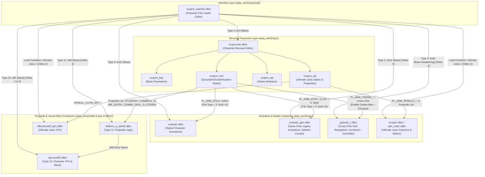

# RESOURCE DEPENDENCY MAP & BINARY FORMAT SPECIFICATION (`NSC-MOVESET-RESEARCH-001`)

## 1. Tabel Enum `Type` pada `Character File Loader Editor` (`xxxprm_load.bin.xfbin`)

Berdasarkan tangkapan layar dropdown `Type (required for psu/effects)` pada [Video 3 (`XMqRwv2715s` detik `01:33`)](https://www.youtube.com/watch?v=XMqRwv2715s), berikut adalah skema indeks tipe resource di dalam `xxxprm_load.bin.xfbin`:

| Nilai Indeks (`Type`) | Nama Tipe di UI `NSC Toolbox` | Direktori Umum (`File Path`) | Fungsi & Contoh File Terverifikasi | Status Bukti |
| :--- | :--- | :--- | :--- | :--- |
| **`0`** | `0 - empty` | — | Entri kosong / tidak aktif. | `[VERIFIED IN VIDEO]` |
| **`1`** | `1 - common file` | `spc` | File umum yang dipakai bersama. | `[VERIFIED IN VIDEO]` |
| **`2`** | `2 - prm` | `spc` | File parameter moveset utama (`spc/1nrtprm.bin.xfbin`, `spc/1sskprm.bin.xfbin`). | `[VERIFIED IN VIDEO]` |
| **`3`** | `3 - bod1` | `spc` | Container model/animasi kostum utama atau tambahan (`spc/1sskbod1.xfbin`, `spc/1sskbod1_gen.xfbin`, `spc/2skrbod1_t.xfbin`). | `[VERIFIED IN VIDEO]` |
| **`4`** | `4 - bod2` | `spc` | Container model/animasi kedua (misal mode Awakening / bentuk perubahan). | `[VERIFIED IN VIDEO]` |
| **`5`** | `5 - btl` | `spc` | Resource pertarungan khusus (`btl`). | `[VERIFIED IN VIDEO]` |
| **`6`** | `6 - eff` | `effect` / `spc` | Container efek umum. | `[VERIFIED IN VIDEO]` |
| **`7`** | `7 - mot` | `spc/ccodeMotion` | Container motion bersama (`spc/ccodeMotion/mot1.xfbin`, `ougi1.xfbin`). | `[VERIFIED IN VIDEO]` |
| **`8`** | `8 - trl1` | `spc` | Container jejak serangan (*trail 1*). | `[VERIFIED IN VIDEO]` |
| **`9`** | `9 - trl2` | `spc` | Container jejak serangan sekunder (*trail 2*). | `[VERIFIED IN VIDEO]` |
| **`10`** | `10 - eff1` | `spc` / `effect` | Container efek karakter utama (`spc/5mdreff1.xfbin`, `effect/1skreff1_bbt.xfbin`). | `[VERIFIED IN VIDEO]` |
| **`11`** | `11 - skill` | `skill` | Container logika/entri proyektil dan skill (`skill/5mdr_a_skn00.xfbin`, `skill/1nrtspl1_a.xfbin`). | `[VERIFIED IN VIDEO]` |
| **`13`** | `13 - param file` | `spc` | File parameter tambahan (`spc/ccode_comboPrm.xfbin`). | `[VERIFIED IN VIDEO]` |
| **`14`** | `14 - std file` | `spc` | File standar tambahan. | `[VERIFIED IN VIDEO]` |

## 2. Tabel Bitflag `Load Condition` pada `xxxprm_load.bin.xfbin` (`[VERIFIED IN VIDEO]`)

Di dalam `Character File Loader Editor` (`XMqRwv2715s` `01:05`, `K_DrvEl2XBE` `01:39`), setiap resource yang dimuat memiliki 12 kotak centang kondisi pemuatan:
- **Kolom Kiri**: `Base`, `Awakening`, `Jutsu 1`, `Jutsu 2`, `Jutsu 3`, `Jutsu 4`, `Jutsu 5`, `Jutsu 6`.
- **Kolom Kanan**: `Support`, `Ultimate Jutsu 1`, `Ultimate Jutsu 2`, `Ultimate Jutsu 3`, `Ultimate Jutsu 4`.

## 3. Diagram Dependensi Resource Lintas 5 Modifikasi (Mermaid)

